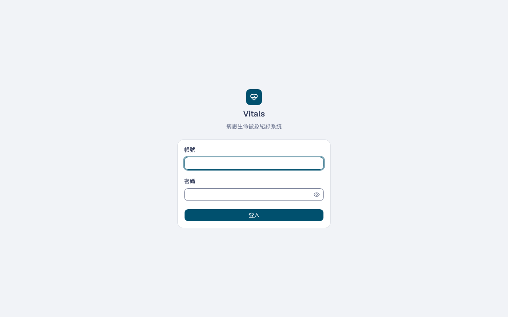
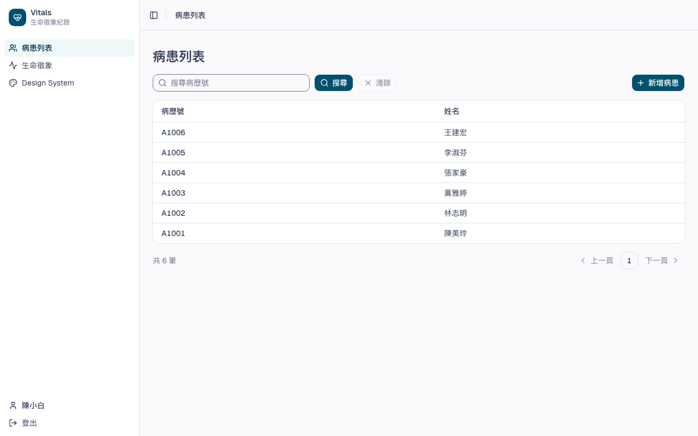
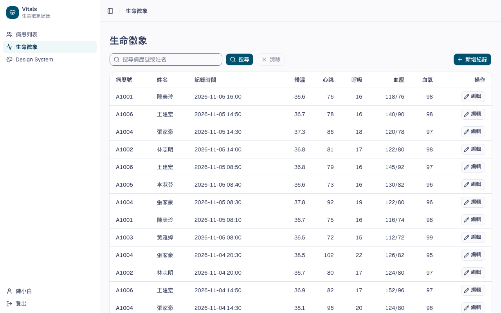

# Vitals：病患生命徵象紀錄系統

病房護理師登入後，替病患記錄生命徵象並查看歷次紀錄。

## 截圖

### 登入

### 病患列表

### 生命徵象紀錄

## 功能

- 登入
- 病患：列表、新增、查看
- 生命徵象：新增、編輯紀錄（體溫、心跳、呼吸、血壓、血氧），列表可用病歷號或姓名搜尋

## 技術

| 項目 | 選擇 |
|---|---|
| 後端 | Spring Boot 4.x（Java 25、Maven） |
| 前端 | Next.js、shadcn/ui |
| 資料庫 | PostgreSQL 18 |
| 資料表變更 | Flyway |
| 測試 | JUnit 5 + Testcontainers、Vitest、Playwright |
| API 文件 | springdoc-openapi（Swagger UI） |

開發文件見 [docs/](docs/README.md)。

## TODO

- 非功能性需求
- 資訊安全管理：須遵守 ISO 27001（ISMS）
- production 環境關閉 Swagger UI 與 API 文件（`/swagger-ui`、`/v3/api-docs`）：目前本機與 dev 都公開
- 共用欄位 `deletedBy`（刪除者）：`@SoftDelete` 刪除時只填 `deleted_at`，呼叫 `delete` 後 Hibernate 也不會寫入其他修改，要另外處理
- 登入失敗次數限制：防暴力破解（OWASP ASVS）
- 生命徵象的合理範圍與數值檢查（例如收縮壓需高於舒張壓）：需臨床人員確認後再加
- 登出後，已發出的 JWT 到期前仍然有效：驗證 JWT 不查資料庫，登出只清除瀏覽器的 cookie
- log 設定
-  系統架構
- cicd
