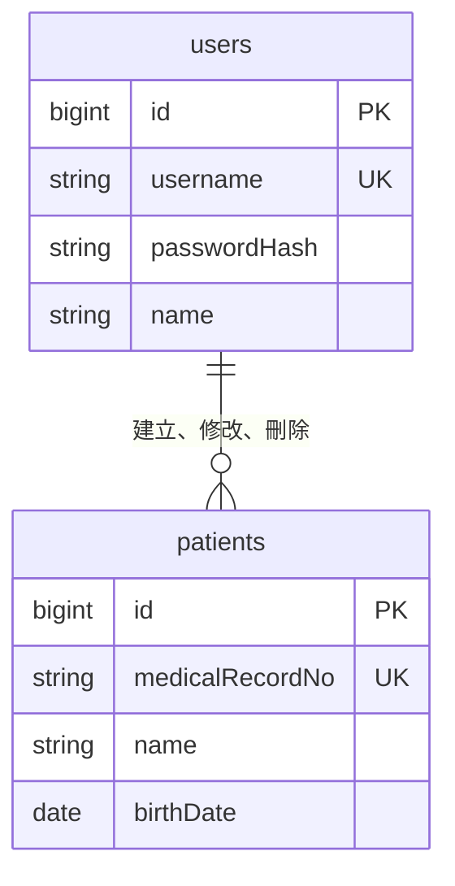

# 資料模型

> 狀態：草稿

## 1. ERD

- 共用欄位不畫；各表的 `createdBy`、`updatedBy`、`deletedBy` 都參照使用者，只畫一條代表

## 2. 資料表

- 表名用英文複數、snake_case；欄位名稱在資料庫是 snake_case（例如 `createdAt` → `created_at`）
- 每張表都有下面的共用欄位，各表只列自己的欄位；做法見 [conventions.md](conventions.md) §1.7

| 欄位 | 說明 |
|---|---|
| `id` | 流水號 |
| `createdAt` | 建立時間，含時區 |
| `updatedAt` | 最後修改時間，含時區 |
| `createdBy` | 建立者的使用者 `id`；系統建立時為空 |
| `updatedBy` | 最後修改者的使用者 `id`；系統建立時為空 |
| `deletedAt` | 刪除時間，含時區；空值表示未刪除 |
| `deletedBy` | 刪除者的使用者 `id` |

### 2.1 使用者（`users`）

| 欄位 | 說明 |
|---|---|
| `username` | 帳號，最多 50 個字，唯一，含已刪除的資料 |
| `passwordHash` | 雜湊後的密碼 |
| `name` | 姓名 |

### 2.2 病患（`patients`）

| 欄位 | 說明 |
|---|---|
| `medicalRecordNo` | 病歷號，唯一，含已刪除的資料 |
| `name` | 姓名 |
| `birthDate` | 生日 |

### 2.3 生命徵象（`vital_signs`）

<!-- 欄位名稱與型別等 vital-signs spec 定案後再寫 -->

| 項目 | 英文 | 單位 |
|---|---|---|
| 體溫 | Body Temperature | °C |
| 心跳 | Heart Rate | 次/分 |
| 呼吸 | Respiratory Rate | 次/分 |
| 收縮壓／舒張壓 | Systolic / Diastolic Blood Pressure | mmHg |
| 血氧 | SpO₂ | % |

## 3. 不變條件

<!-- 任何時候都必須成立的規則，每條都要有測試 -->
