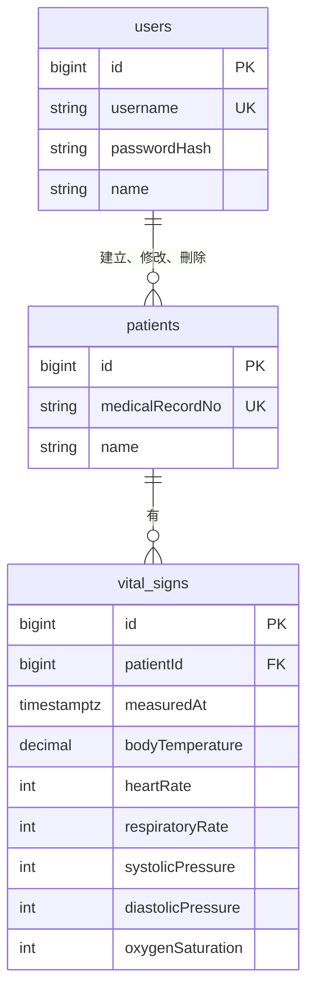

# 資料模型

> 狀態：草稿

## 1. ERD

- 共用欄位不畫；各表的 `createdBy`、`updatedBy` 都參照使用者，只畫一條代表

## 2. 資料表

- 表名用英文複數、snake_case；欄位名稱在資料庫是 snake_case（例如 `createdAt` → `created_at`）
- 每張表都有下面的共用欄位，各表只列自己的欄位；做法見 [conventions.md](conventions.md) §1.7

| 欄位 | 說明 |
|---|---|
| `id` | 流水號 |
| `createdAt` | 建立時間，含時區 |
| `updatedAt` | 最後修改時間，含時區 |
| `createdBy` | 建立者的使用者 `id`；系統建立時為空 |
| `updatedBy` | 最後修改者的使用者 `id`；系統建立時為空 |
| `deletedAt` | 刪除時間，含時區；空值表示未刪除 |

### 2.1 使用者（`users`）

| 欄位 | 說明 |
|---|---|
| `username` | 帳號，最多 50 個字，唯一，含已刪除的資料 |
| `passwordHash` | 雜湊後的密碼 |
| `name` | 姓名 |

### 2.2 病患（`patients`）

| 欄位 | 說明 |
|---|---|
| `medicalRecordNo` | 病歷號，英文字母與數字，最多 20 個字，一律存成大寫；唯一，含已刪除的資料 |
| `name` | 姓名，最多 50 個字 |

### 2.3 生命徵象（`vital_signs`）

- 數值只限制格式與位數，不限制醫學上的合理範圍，理由見[生命徵象 spec](specs/vital-signs/spec.md) §5

| 欄位 | 說明 |
|---|---|
| `patientId` | 病患，參照 `patients` |
| `measuredAt` | 記錄時間，含時區，到分鐘；同一位病患的記錄時間唯一，含已刪除的資料 |
| `bodyTemperature` | 體溫（°C），0～999.9，最多 1 位小數 |
| `heartRate` | 心跳（次/分），0～999 的整數 |
| `respiratoryRate` | 呼吸（次/分），0～999 的整數 |
| `systolicPressure` | 收縮壓（mmHg），0～999 的整數 |
| `diastolicPressure` | 舒張壓（mmHg），0～999 的整數 |
| `oxygenSaturation` | 血氧（%），0～999 的整數 |

## 3. 不變條件

<!-- 任何時候都必須成立的規則，每條都要有測試 -->
