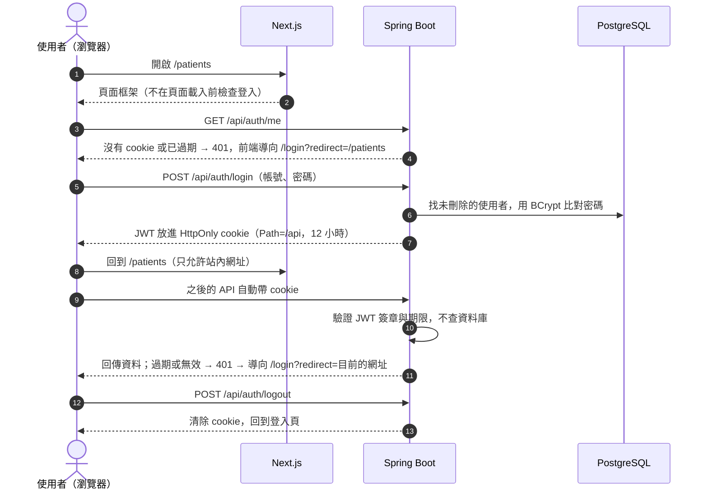

# 登入

> 狀態：定案

## 1. 目的

- 護理師用帳號密碼登入；沒登入的人看不到病患資料

## 2. 需求

### REQ-AUT-001 登入

- 用帳號密碼登入，成功後進入病患列表

- **AC1 登入成功**〔後端、E2E〕：Given 預設帳號存在 When 輸入正確的帳號密碼 Then 進入病患列表
- **AC2 帳號或密碼錯誤**〔後端、E2E〕：Given 預設帳號存在 When 帳號不存在或密碼錯誤 Then 停在登入頁，顯示「帳號或密碼錯誤」，不說明是哪一個錯
- **AC3 欄位空白**〔後端、E2E〕：When 帳號或密碼沒填就送出 Then 該欄位顯示必填提示，不送出；不經畫面直接送出空白資料時被拒絕
- **AC4 超過字數**〔後端、E2E〕：When 帳號輸入超過 50 個字或密碼超過 64 個字 Then 輸入框不接受超過的字；不經畫面直接送出超過字數的資料時被拒絕

### REQ-AUT-002 預設帳號

- 不開放註冊，系統啟動時依環境變數建立帳號

- **AC1 啟動時建立**〔後端〕：Given 資料庫沒有這個帳號 When 系統啟動 Then 可以用環境變數設定的帳號密碼登入
- **AC2 帳號已存在**〔後端〕：Given 帳號已存在 When 系統再次啟動 Then 不重複建立，也不依環境變數更新密碼
- **AC3 帳號設定不正確**〔後端〕：Given 預設帳號的環境變數沒設定，或不符合規定（帳號超過 50 個字、密碼超過 64 個字或 72 byte）When 系統啟動 Then 啟動失敗，並說明是哪個環境變數有問題

### REQ-AUT-003 未登入時導向登入頁

- 登入有效期限 12 小時：涵蓋加班，隔天一定要重新登入

- **AC1 未登入不能讀取資料**〔後端〕：Given 未登入 When 讀取病患資料 Then 被拒絕
- **AC2 未登入開啟頁面**〔E2E〕：Given 未登入 When 開啟病患列表 Then 導向登入頁
- **AC3 登入過期**〔後端、E2E〕：Given 登入已超過 12 小時 When 操作需要資料的頁面 Then 導向登入頁
- **AC4 登入後回到原頁面**〔前端、E2E〕：Given 未登入時開啟某頁被導向登入頁 When 登入成功 Then 回到原本那頁；指定的網址不是站內網址時，改進入病患列表

### REQ-AUT-004 登出

- 登出後回到登入頁，同一台電腦不能再讀取資料

- **AC1 登出**〔後端、E2E〕：Given 已登入 When 按登出 Then 回到登入頁，之後再讀取病患資料被拒絕

### REQ-AUT-005 目前登入者

- 畫面顯示目前是誰登入；已登入時不用再登入

- **AC1 顯示姓名**〔後端、E2E〕：Given 已登入 When 開啟任何頁面 Then 側邊欄顯示登入者的姓名
- **AC2 已登入開啟登入頁**〔E2E〕：Given 已登入 When 開啟登入頁 Then 進入病患列表

## 3. API

| 方法 | 路徑 | 用途 | 對應 REQ |
|---|---|---|---|
| POST | `/api/auth/login` | 登入，成功時把 JWT 放進 cookie | AUT-001 |
| POST | `/api/auth/logout` | 登出，清除 cookie | AUT-004 |
| GET | `/api/auth/me` | 目前登入者 | AUT-003、AUT-005 |

## 4. 畫面

### 登入頁 `/login`

- 版型：空白版型，畫面置中的卡片（參考 shadcn `login-03`，不含社群登入與註冊）
- 入口：未登入時開啟任何頁面（REQ-AUT-003）

```
┌──────────────────────────────┐
│            Vitals            │
│      病患生命徵象紀錄系統      │
│                              │
│  ┌────────────────────────┐  │
│  │ ⚠ 帳號或密碼錯誤        │  │  ← FormAlert，有錯時才顯示
│  └────────────────────────┘  │
│  帳號                        │
│  [                        ]  │
│    請輸入帳號                │  ← 必填提示
│  密碼                        │
│  [                     👁 ]  │
│                              │
│  [          登入          ]  │
└──────────────────────────────┘
```

#### 欄位

| 欄位 | 類型 | 必填 | 限制 | 行為 |
|---|---|---|---|---|
| 帳號 | `TextField` | 是 | 最多 50 個字，輸入框不接受超過的字（REQ-AUT-001 AC4） | 開啟時取得焦點；瀏覽器自動填入類型為帳號（`autocomplete="username"`） |
| 密碼 | `PasswordField` | 是 | 最多 64 個字，輸入框不接受超過的字（REQ-AUT-001 AC4） | 瀏覽器自動填入類型為目前密碼（`autocomplete="current-password"`） |
| 登入 | `SubmitButton` | — | — | — |

#### 畫面行為

- 在帳號或密碼欄按 Enter 就送出
- 登入失敗後清空密碼、保留帳號，焦點移到密碼欄
- 登入成功後回到原本的頁面，沒有原頁面就進入病患列表（REQ-AUT-003 AC4）

### 側邊欄的登入者與登出

- 入口：登入後的所有頁面

#### 畫面行為

- 側邊欄底部顯示登入者的姓名（REQ-AUT-005 AC1）與登出按鈕（REQ-AUT-004）
- 登出不跳確認視窗，直接登出

## 5. 做法

### 流程



- 驗證 JWT 不查資料庫，帳號刪除後已發出的 JWT 到期前仍然有效：目前沒有刪除帳號的功能

### 後端

- 用 Spring Security 內建的 `oauth2-resource-server` 驗證 JWT，用 `JwtEncoder` 簽發，不另外引入第三方 JWT 套件
- 密碼用 BCrypt 雜湊後儲存；BCrypt 只處理前 72 byte，中文一個字 3 byte，所以建立帳號時另外檢查 byte 數
- 登入時不檢查密碼太短：會透露密碼規則
- 預設帳號用 `CommandLineRunner` 在啟動時建立，帳號、密碼、姓名從環境變數讀取
- JWT 的 `sub` 放使用者 `id`：`createdBy` 等欄位存的是使用者 `id`，見 [conventions.md](../../../conventions.md) §1.7
- Session 設為 stateless
- 有效期限從設定讀取，預設 12 小時：測試可以縮短，用來驗證過期

### JWT cookie

- JWT 放在 cookie：前後端同網域，瀏覽器呼叫 `/api` 時自動帶上
- `HttpOnly`：前端 JavaScript 讀不到
- `SameSite=Strict`：其他網站發出的請求不會帶 cookie，用來防 CSRF，所以關閉 Spring 的 CSRF token
- `Path=/api`：只送給後端 API，前端頁面的請求不帶；登出清除時 `Path` 要相同，否則瀏覽器會當成另一個 cookie，刪不掉
- `Secure`：dev 環境（HTTPS）加上
- 預設的 `BearerTokenResolver` 只讀 `Authorization` header，要改成從 cookie 讀

### 前端

- 不儲存、不讀取 token
- 不用 Next.js `proxy.ts` 在頁面載入前檢查登入，由 API 回應判斷，處理方式見 [conventions.md](../../../conventions.md) §2.2：資料由後端驗證把關，未登入時最多先看到頁面框架、看不到資料，換來前端少一層邏輯
- 共用 layout 載入時呼叫 `GET /api/auth/me`：取得要顯示的姓名，也知道是否已登入；JWT 在 httpOnly cookie，前端讀不到裡面的資料
- 登出呼叫 `POST /api/auth/logout`，由後端清除 cookie：前端 JavaScript 刪不掉 httpOnly cookie

## 6. 資料

- 欄位與關聯見 [data-model.md](../../../data-model.md) §2.1

| 資料 | 本功能的用法 | 說明 |
|---|---|---|
| 使用者（`users`） | 新增、讀取 | 啟動時建立預設帳號（REQ-AUT-002）；登入時比對帳號密碼（REQ-AUT-001）；`me` 讀取姓名（REQ-AUT-005） |
